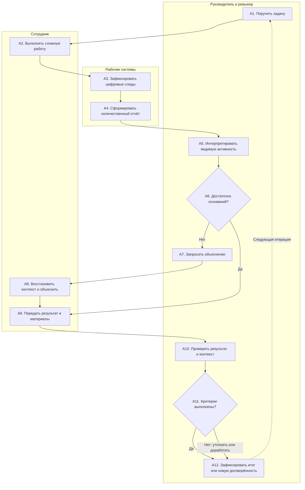

# Опора — анализ AS-IS

**Статус:** черновик этапа 2 для командного ревью. Сдача этапа пока не заявлена. Описанные целевые процессы и показатели не являются результатами внедрения. Новые решения требуют голосования команды; исходные измерения ещё не проведены.

## Границы процесса

Начало: сотруднику поручена задача. Конец: руководитель рассмотрел результат/объяснение и зафиксировал следующую договорённость. Участники: сотрудник, руководитель/ревьюер, действующие рабочие системы. Модель описывает проблемный сценарий оценки, **не подтверждённый процесс конкретной организации**. На этапе исследования она должна быть сопоставлена с интервью и обезличенными примерами документов.

Кейс: исследовательская задача по выбору технического подхода. Полезный результат — сравнение вариантов и аргументированный отказ от неподходящего решения; число закрытых тикетов или нажатий за день этого не отражает.

## Диаграмма процесса

Формат — Mermaid flowchart с дорожками ролей; это процессная схема, не заявление о соблюдении полной нотации BPMN 2.0. Идентификаторы A1–A12 соответствуют таблице ниже.



## Шаги процесса

Время и частота ниже — параметры проверяемой модели. «Не измерено» не означает нулевые затраты. Дневной количественный отчёт — условие рассматриваемого сценария, а не установленная практика всех работодателей.

| № | Шаг | Роль | Вход | Выход | Система | Время | Частота | Ожидание |
|---|---|---|---|---|---|---|---|---|
| A1 | Поручить задачу | Руководитель | Запрос заказчика | Задача, иногда неполные критерии | Трекер | Не измерено | По задаче | Согласование |
| A2 | Выполнять сложную работу | Сотрудник | Задача | Промежуточное знание/материал | IDE, документы | Не измерено | Рабочий цикл | Зависимости |
| A3 | Зафиксировать цифровые следы | Система | Рабочие события | События, не смысл работы | Трекер/мониторинг | Не измерено | По событию | Загрузка |
| A4 | Сформировать количественный отчёт | Система | События | Количества и интервалы | Отчёт | Не измерено | В сценарии ежедневно | До отчёта |
| A5 | Интерпретировать видимую активность | Руководитель | Отчёт | Предварительное мнение | Отчёт/трекер | Не измерено | По обзору | Очередь обзора |
| A6 | Достаточно оснований? | Руководитель | Мнение, доступные данные | Ветвление | Трекер | Не измерено | По обзору | Не установлено |
| A7 | Запросить объяснение | Руководитель | Недостаток оснований | Вопрос сотруднику | Рабочий канал | Не измерено | При сомнении | Ответ |
| A8 | Восстановить контекст и объяснить | Сотрудник | Вопрос, разрозненные записи | Пояснение и ссылки | Документы/трекер | Не измерено; S1 — только расчётный пример | При запросе | Возврат к глубокой работе |
| A9 | Передать результат и материалы | Сотрудник | Результат/пояснение | Пакет для проверки | Трекер | Не измерено | По контрольной точке | Ревью |
| A10 | Проверить результат и контекст | Ревьюер | Материалы и критерии | Проверенное заключение | Трекер/репозиторий | Не измерено | По результату | Эксперт |
| A11 | Критерии выполнены? | Ревьюер | Заключение | Приёмка или доработка | Трекер | Не измерено | По проверке | Не установлено |
| A12 | Зафиксировать итог/пересогласовать | Руководитель и сотрудник | Приёмка/расхождения | Решение, следующий шаг | Трекер | Не измерено | По циклу | Новые зависимости |

## Источники данных

### Опубликованное основание постановки

| ID | Первоисточник | Что используем в анализе |
|---|---|---|
| E1 / P09 | Ravid et al. (2023), [DOI 10.1111/peps.12514](https://doi.org/10.1111/peps.12514) | Результаты метаанализа электронного мониторинга; проверяем риск подмены результата наблюдением |
| E2 / P10 | Mark, Gudith, Klocke (2008), [DOI 10.1145/1357054.1357072](https://doi.org/10.1145/1357054.1357072) | Экспериментальные данные о нагрузке при прерываниях; проверяем запросы статуса и затраты |
| E3 / P01–P02 | [SPACE](https://doi.org/10.1145/3454122.3454124), [DevEx](https://doi.org/10.1145/3610285) | Разделяем активность, результат и условия работы; не сводим их к одному индексу |
| E4 / P11 | Harkin et al. (2016), [DOI 10.1037/bul0000025](https://doi.org/10.1037/bul0000025) | Экспериментальная база отслеживания продвижения к цели; ориентир для проектирования записи прогресса |

Полная библиография и результаты исследований — в [реестре](01_problem.md#sources).

### Данные организации, которые нужно получить

E5 — план сбора, пока без наблюдений. Нужны: 2–3 сотрудника разных типов задач, 1–2 руководителя/ревьюера и 5–10 завершённых или заблокированных задач. Это разведочная, не репрезентативная выборка.

| Данные | Как получить | Что проверить |
|---|---|---|
| Карточка задачи и версии критериев | Разрешённый обезличенный пример из существующего трекера | Что было согласовано до начала работы |
| Материал результата и итог приёмки | Минимальная выдержка или проверка у владельца, без копирования кода | На каких основаниях принят результат |
| Запросы статуса и ответы | Разбор конкретного случая с участником, без выгрузки личных чатов | Что повторяют и сколько активного времени тратят |
| Блокеры и зависимости | Рабочие статусы, интервью по последней задаче | Причина ожидания и кто мог её устранить |
| Труд сотрудника и ревьюера | Добровольный дневник коротких событий | M1: обе стороны, настройка, исправления и поддержка |

### Проверка шагов A1–A12

Карта — аналитическая модель для проверки на E5. Публикации обосновывают исследовательский вопрос; конкретный порядок работы устанавливается по данным организации.

| Шаги | Логика модели | Проверка на E5 |
|---|---|---|
| A1–A2 | Цель и сложная работа; ориентиры E3–E4 | Как ставят задачу и определяют результат |
| A3–A6 | Возможная подмена содержания количественным отчётом; ориентиры E1/E3 | Есть ли мониторинг и влияет ли он на решение |
| A7–A8 | Возможные повторные объяснения и прерывания; ориентир E2 | Последний случай, частота, активные минуты, уже доступный контекст |
| A9–A12 | Проверка результата и новая договорённость; ориентир E4 | Кто принимает материал, по каким критериям и как фиксирует итог |

Карту проверяют минимум сотрудник и руководитель. Если порядок иной или потери отсутствуют, модель меняется до выбора решения.

## Обнаруженные проблемы

**Статус раздела: гипотезы проблем для проверки, а не обнаруженные факты организации.** Название обязательной секции сохранено для совместимости с учебным валидатором. P1–P6 — кандидаты, полученные из реконструкции A1–A12; название типа потери показывает классификацию гипотезы, а не установленный факт.

| ID | Шаг | Тип потери | Гипотеза механизма | Связь с противоречием | Что опровергнет гипотезу |
|---|---|---|---|---|---|
| P1 | A5–A6 | Невидимое знание | Действия интерпретируются как качество без материалов | Количественный суррогат вытесняет оценку результата | Решения уже основаны на содержательном ревью |
| P2 | A7–A8 | Лишний шаг, дублирование | Работник повторно восстанавливает контекст | Демонстрация занятости расходует время | Пояснение уже есть и не дублируется |
| P3 | A2, A8 | Потеря мотивации, переключение | Частые запросы прерывают длинную задачу | Глубокая работа становится затратной стратегией | Запросы редки и не мешают работе |
| P4 | A9–A10 | Ожидание, точка отказа | Ревьюер недоступен, критерии не согласованы | Качество не становится видимым своевременно | Приёмка быстрая и критерии определены |
| P5 | A6–A12 | Точка отказа | Нет фиксации невыполненной договорённости и действий поддержки | Реальное невыполнение скрывается за агрегатами/самоотчётом | Ответственность уже фиксируется и разбирается |
| P6 | A3–A5 | Избыточные данные | Сбор активности шире потребности в проверке результата | Защита от недоверия порождает дополнительный контроль | Собираются только необходимые данные |

Административное требование «работать активнее» сохраняет исходный суррогат. Но простое удаление мониторинга также не определяет критерии приёмки и ответственность. Проверяем изменение процесса, а не только замену интерфейса.

## Оценка потерь

**Иллюстративный сценарий S1, все числа вымышлены.** Он показывает только способ расчёта [M1](01_problem.md#m1--совокупные-трудозатраты-на-подготовку-и-проверку), а не ожидаемый эффект.

```text
N = число сотрудников
D = число рабочих дней на одного сотрудника в условном равном окне; всего N × D сотруднико-дней
t₀ = минуты повторных объяснений на сотруднико-день до изменения
t₁ = минуты подготовки карточки на сотруднико-день после изменения
R₀ = суммарные часы руководителя/ревьюера до изменения
ΔR = дополнительные часы руководителя/ревьюера после изменения

T₀ = N × D × t₀ / 60 + R₀
T₁(ΔR) = N × D × t₁ / 60 + R₀ + ΔR
Экономия(ΔR) = T₀ − T₁(ΔR)
Экономия%(ΔR) = (T₀ − T₁(ΔR)) / T₀ × 100%
```

Подстановка `N=8`, `D=10`, `t₀=15`, `t₁=10`, `R₀=1` даёт `T₀=21 ч`. Труд сотрудника меняется с 20 до 13,33 часа; валовая экономия без дополнительного ревью равна 6,67 часа.

- При `ΔR=+1 ч` время руководителя растёт с 1 до 2 часов: `T₁=15,33 ч`, чистая экономия `5,67 ч`, или **26,98%**.
- При `ΔR=+2 ч` время руководителя растёт с 1 до 3 часов: `T₁=16,33 ч`, чистая экономия `4,67 ч`, или **22,22%**.

Оба результата условны. Стоимость интеграции, настройки, обучения и исправлений здесь не включена и должна учитываться отдельно; после добавления этих затрат порог 20% может быть не достигнут.

Чувствительность: при 12 минутах карточки суммарно 18 ч и экономия 3 ч (14,29%, ниже цели 20%). При 15 минутах карточки и 2 часах ревью суммарно 22 ч — ухудшение на 1 ч. Следовательно, красивый отчёт без сокращения труда может провалить бизнес-цель.

Не складывать календарное ожидание задачи с активными человеко-часами: это разные величины. Не монетизировать ожидание без модели влияния на выпуск. Восстановление концентрации пока не оценено и в экономию не включено.

## Связь с этапом 1

P1–P3 непосредственно раскрывают конфликт качества и демонстрации действий из [01](01_problem.md). P4–P5 объясняют, почему недостаточно защищать фокус: нужно проверять результат и договорённость. P6 задаёт границы данных. Рабочий проект TO-BE в общей папке команды показывает, какие изменения закрывают каждую проблему. Если E5 не подтвердит P1/P2/P3, пересмотреть формулу и отказаться от внедрения ради исходной идеи.

---

<a id="context"></a>

## Область подготовки

Противоречие и презентация первого этапа представлены 15.10.2026. Последующая доработка включает новые итерации и проверку домена. Анализ AS-IS, архитектура, требования и глоссарий — отдельные материалы проекта.

## Конкретный кейс и сбор контекста

Иллюстративный кейс основной аудитории: исследователь сравнивает два технических подхода. На день количественного отчёта готового внедрения нет, но есть проверка ограничений и отказ от неподходящего варианта. Руководителю нужны основания решения и следующий шаг. Возможная потеря возникает на A5–A8, если этот материал приходится восстанавливать и объяснять заново. Сценарий не выдаётся за наблюдение конкретной компании.

Для каждого исследованного случая фиксируем: исходную версию задачи и критерия; предъявленный материал; блокеры; запросы объяснений; минуты обеих сторон; результат приёмки. Раздельно проверяем, что запрос вызван не отсутствием реальной работы, не сбоем источника и не изменением критерия после выполнения.

Обратный разбор появления трекера, цепочка C1–C3 и критерии выбора домена: [паспорт противоречия](01_problem.md).

## Исследовательские вопросы

1. Какие основания реально меняют решение о результате задачи?
2. Где повторяется объяснение уже доступного контекста и какова его стоимость?
3. Устраняет ли достаточная договорённость проблему без нового приложения?
4. Как различить материал, блокер, невыполнение и технический пробел в данных?
5. Какой вариант выигрывает у текущей практики по времени и качеству разбора?

Перед экспериментом зафиксировать критерии, исходный процесс и правила доступа. Данные E5 затем обновят карту, расчёт потерь и выбор подхода.

## Проверка сложной задачи до изменения процесса

Минимальный разбор кейса: задача и родительская цель; критерий, согласованный до результата; версия материала; состояние и причина его изменения; прогноз с допущениями; внешняя зависимость и её владелец; решение принимающего. Это перечень вопросов исследования, а не требование ежедневного отчёта.

| Проверяем | Конкретный вопрос по последнему случаю | Ошибка интерпретации, которую исключаем |
|---|---|---|
| Дробление | Одна ли родительская цель у закрытых подзадач? Изменился ли принятый результат? | 50 подзадач приравнены к 50 результатам |
| Неопределённость | Что было неизвестно до работы и что удалось установить? | Отрицательный ответ исследования объявлен отсутствием работы |
| Зависимость | Кто должен был дать ресурс/ответ и когда запросили? | Всё календарное ожидание приписано исполнителю |
| Оценка срока | Кто оценил, с какими допущениями, когда изменился объём? | Отклонение на 5–7% автоматически стало невыполнением |
| Встречи | Какое решение или материал использован дальше? Нужен ли вообще протокол этой встречи? | Продолжительность звонка заменяет ценность и требует стенограммы всех разговоров |
| Текущая лёгкая практика | Достаточны ли уже доска задач и содержательное ревью? | Новый слой отчётности добавлен там, где проблемы нет |

Для каждого P1–P6 сохранить как минимум один подтверждающий либо опровергающий обезличенный кейс и позицию сотрудника/принимающего. Наблюдения, ответы и разрешение владельца данных пока не получены. До этого карта пригодна для рецензирования как исследовательская модель; окончательную сдачу эмпирического AS-IS не объявляем выполненной.

Готовый сценарий проверки: попросить исполнителя восстановить последнюю сложную задачу, затем отдельно принимающего объяснить основание приёмки. Сопоставить версии, выявить расхождения, уточнить карту A1–A12 и только затем измерять частоту и стоимость. Не собирать записи всех встреч или личные переписки. Источник трудовых норм, реальную частоту и наличие инструментов установить у владельца процесса, а не выводить из публикаций.
