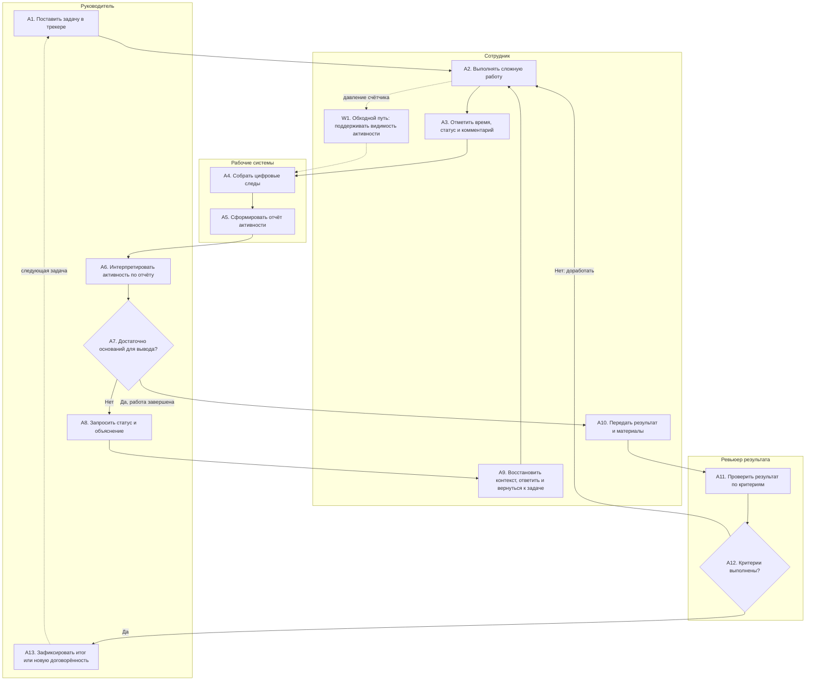

# Опора — анализ AS-IS

**Что моделируем.** Текущий процесс оценки сложной задачи в продуктовой IT-команде, где руководитель видит работу через трекер задач и цифровые следы активности. Модель собрана из трёх типов данных: опубликованных исследований с измерениями, разведочных интервью с практиками и документации рабочих систем. У каждого утверждения ниже указан источник из раздела [«Источники данных»](#источники-данных); допущения помечены `Д` и вынесены в план проверки.

## Границы процесса

| Параметр | Значение |
|---|---|
| Домен | Российская продуктовая IT-компания на 50–500 сотрудников с гибридной или удалённой работой; команда разработки и исследований из 6–10 специалистов с одним руководителем; задачи ведутся в Jira или аналогичном трекере, учёт времени включён (И1, С1) |
| Событие начала | Руководитель поставил сложную задачу в трекере (исследование, проектирование, нетиповая разработка) |
| Событие конца | Итог задачи зафиксирован: результат принят, отправлен на доработку или заключена новая договорённость |
| Владелец процесса | Руководитель команды |
| Участники | Сотрудник, руководитель, ревьюер результата; системы: трекер задач, средства учёта времени и мониторинга активности |
| Частота | Один цикл на задачу; длительность цикла — от 1 до 10 рабочих дней, внутри цикла ежедневные шаги учёта и обзора |
| Объём модели | 14 узлов: 12 шагов основного потока, обходной путь W1 и решение A12 |
| Внутри границ | Постановка, выполнение, учёт времени и статусов, сбор цифровых следов, интерпретация активности, запрос статуса, объяснение, передача и проверка результата, фиксация итога |
| Вне границ | Найм, оплата и премирование, регулярная аттестация и решения об увольнении, обучение, диагностика выгорания. Эти процессы могут потреблять данные AS-IS, но не моделируются |

Единица анализа совпадает с этапом 1: один цикл согласования и проверки результата задачи ([01](01_problem.md#контекст)).

## Диаграмма процесса

Дорожки соответствуют ролям, идентификаторы совпадают с таблицей шагов. Пунктиром показан обходной путь W1, через который сотрудник подстраивается под оценку по следам.



## Шаги процесса

Время указано на одного сотрудника. Диапазон «низкий / базовый / высокий» используется в [оценке потерь](#оценка-потерь).

| № | Шаг | Роль | Вход | Выход | Система | Время | Частота | Источник |
|---|---|---|---|---|---|---|---|---|
| A1 | Поставить задачу в трекере | Руководитель | Запрос заказчика или цель команды | Карточка задачи; критерии результата часто неполные | Трекер задач | 10–30 мин на задачу | Раз в цикл | И1, И2; Д5 |
| A2 | Выполнять сложную работу | Сотрудник | Задача, материалы | Промежуточное знание, черновики, отрицательные результаты проверок | IDE, документы | Основная часть дня; непрерывный отрезок около 11 мин | Ежедневно | Л3, Л5 |
| A3 | Отметить время, статус и комментарий | Сотрудник | Выполненная работа | Запись в журнале работ, статус задачи | Трекер задач, журнал работ | 5 / 10 / 15 мин в день | Ежедневно, по каждой задаче | И1, Л10; Д1 |
| A4 | Собрать цифровые следы | Система | Записи трекера, время в сети, события активности | Количества и интервалы | Трекер, мониторинг активности | Автоматически | Непрерывно | Л7, Л8, Л9 |
| A5 | Сформировать отчёт активности | Система | Цифровые следы | Отчёт: закрытые задачи, часы, активность | Отчёт или дашборд | Автоматически | Ежедневно или еженедельно | Л8, Л9 |
| A6 | Интерпретировать активность по отчёту | Руководитель | Отчёт активности | Предварительный вывод о работе сотрудника | Отчёт, трекер | 3 / 5 / 10 мин на сотрудника в день | Ежедневно | Л7, Л8; Д3 |
| A7 | Достаточно оснований для вывода? | Руководитель | Вывод A6, доступные материалы | Ветвление: принять или запросить объяснение | — | Входит в A6 | Ежедневно | Л7 |
| A8 | Запросить статус и объяснение | Руководитель | Недостаток оснований, сомнение | Внеплановый вопрос сотруднику | Мессенджер, созвон | 2 мин на запрос | 0,5 / 1 / 2 запроса в день | Л4, Л7; Д2 |
| A9 | Восстановить контекст, ответить и вернуться к задаче | Сотрудник | Вопрос, разрозненные записи | Пояснение; возврат к A2 | Мессенджер, документы | Ответ 5 мин, возврат к задаче 0 / 10 / 25 мин | На каждый запрос A8 | Л3, Л4; Д2 |
| W1 | Поддерживать видимость активности | Сотрудник | Знание, что оценивают по следам | Дополнительные следы без нового результата: статус «в сети», дробление задач, закрытие симптомов | Мессенджер, трекер | 0 / 10 / 30 мин в день | Ежедневно у части сотрудников | Л8, Л11, Л12, И2; Д4 |
| A10 | Передать результат и материалы | Сотрудник | Результат | Пакет для проверки | Трекер, репозиторий | 10–20 мин | Раз в цикл | И1 |
| A11 | Проверить результат по критериям | Ревьюер | Пакет, критерии A1 | Заключение | Трекер, репозиторий | Зависит от задачи, ожидание ревьюера | Раз в цикл и после доработки | Л6, Л10 |
| A12 | Критерии выполнены? | Ревьюер | Заключение | Приёмка или доработка | Трекер | Входит в A11 | Раз в цикл | Л6 |
| A13 | Зафиксировать итог или новую договорённость | Руководитель | Решение A12 | Закрытая задача или новые критерии и срок | Трекер | 5–10 мин | Раз в цикл | И1 |

**Где сотрудник обходит процесс.** W1 — реакция участников на оценку по следам, а не придуманный риск. 63% сотрудников держат статус «в сети», когда не работают (Л8). В мае 2024 года банк уволил более десятка сотрудников за имитацию активности клавиатуры (Л12). В службе поддержки при KPI «число закрытых заявок» одни и те же обращения закрываются каждый день, а корневая причина не устраняется (И2). Это признаки того, что сами участники признают проблему.

## Источники данных

### Опубликованные исследования и отчёты

| ID | Источник | Что подтверждает в модели | Ограничение |
|---|---|---|---|
| Л1 | Forsgren et al., [SPACE](https://doi.org/10.1145/3454122.3454124), ACM Queue, 2021 | Продуктивность нельзя свести к одной метрике; метрики активности нельзя использовать отдельно для поощрения или наказания (A5–A6) | Концептуальная рамка, не измерение потерь |
| Л2 | Noda et al., [DevEx](https://doi.org/10.1145/3610285), 2023 | Опыт разработчика определяют обратная связь, когнитивная нагрузка и состояние потока (A2, A9) | Рамка для разработчиков |
| Л3 | Mark, González, Harris, [No task left behind?](https://doi.org/10.1145/1054972.1055017), CHI 2005 | Прерывается 57% рабочих отрезков; непрерывная работа длится около 11 минут; возврат к прерванной задаче — в среднем 25 мин 26 с (A2, A9) | 24 работника умственного труда, большой разброс; 25 мин — верхняя граница потерь |
| Л4 | Mark, Gudith, Klocke, [The cost of interrupted work](https://doi.org/10.1145/1357054.1357072), CHI 2008 | При прерываниях работа выполняется быстрее без видимой потери качества, но стресс растёт с 6,92 до 9,4 по 20-балльной шкале за 20 минут (A8–A9) | Лабораторный эксперимент, N = 48 |
| Л5 | Microsoft, [Work Trend Index 2023](https://www.microsoft.com/en-us/worklab/work-trend-index/will-ai-fix-work) | 57% времени уходит на коммуникацию и 43% на создание; 68% не хватает времени на работу без отвлечений (A2) | Опрос и телеметрия, N = 31 000 |
| Л6 | Atlassian, [State of Teams 2025](https://www.atlassian.com/blog/state-of-teams-2025) | 25% времени руководители и команды тратят на поиск информации (A9, A11) | Опрос, N = 12 000 |
| Л7 | Microsoft, [Hybrid work is just work](https://www.microsoft.com/en-us/worklab/work-trend-index/hybrid-work-is-just-work), 2022 | 85% руководителей не уверены в продуктивности гибридных сотрудников при 87% сотрудников, считающих себя продуктивными; 49% гибридных менеджеров с трудом доверяют сотрудникам (A6–A8) | Опрос, N = 20 006 |
| Л8 | Slack, [State of Work 2023](https://slack.com/blog/news/state-of-work-2023) | 27% руководителей оценивают продуктивность по видимости и активности; 63% сотрудников держат статус «в сети», когда не работают (A4–A6, W1) | Опрос, N = 18 149 |
| Л9 | Ravid et al., [Personnel Psychology](https://doi.org/10.1111/peps.12514), 2023 | Метаанализ 94 выборок, N = 23 461: связь мониторинга с производительностью ρ = −0,01 (незначима), со стрессом ρ = +0,16; широкий мониторинг связан с контрпродуктивным поведением ρ = +0,22; прозрачность улучшает отношение к работе ρ = +0,25 (A4–A6, W1) | Корреляции, не причинность |
| Л10 | Asana, [Anatomy of Work](https://asana.com/resources/anatomy-of-work-infographic), 2021 | 61% времени уходит на «работу о работе»: статусы, поиск, согласования (A3, A9, A11) | Опрос в США |
| Л11 | Campbell, [Assessing the impact of planned social change](https://jmde.journals.publicknowledgeproject.org/index.php/jmde_1/article/view/297), 1979 | Чем сильнее количественный показатель используется для решений, тем сильнее он искажает процесс, который должен отражать (W1) | Теоретический закон |
| Л12 | [Wells Fargo: увольнения за имитацию активности клавиатуры](https://www.wealthmanagement.com/industry/wells-fargo-fires-over-dozen-simulation-keyboard-activity), раскрытие FINRA, 2024 | Реальный случай обходного пути при мониторинге активности (W1) | Единичный кейс |
| Л13 | Хабр Карьера, [зарплаты в IT, I полугодие 2026](https://habr.com/ru/specials/1060148/); [норма времени 2026](https://buh.ru/calendar/2026/) | Медиана 191 000 ₽ в месяц, норма 1 972 ч в год → около 1 162 ₽ за час (перевод потерь в деньги) | Сумма на руки; стоимость для работодателя выше |

### Разведочные интервью с практиками

Самоотчёт о текущей работе, без раскрытия работодателей. Используется как свидетельство устройства процесса, не как статистика.

| ID | Респондент | Что подтверждает |
|---|---|---|
| И1 | Инженер по ИИ в IT-компании и научный сотрудник университета | На основной работе в Jira по каждой задаче нужно отмечать отработанные часы, писать комментарий и ставить статус: «постоянно напрягает эта бюрократия». В исследовательской группе задачи ведут стикерами на доске, «две секунды», чтобы максимум времени оставалось на работу (A1, A3, A10, A13) |
| И2 | Специалист первой линии поддержки | Основной KPI — число закрытых заявок, метрики полезности нет; одни и те же проблемы повторяются каждый день, корневые причины не устраняют, потому что повторно закрывать заявку дешевле (W1, P5) |
| И3 | Студент-аналитик с личным трекером времени | Трекер «ничего не показывает, это просто отсчёт времени»: количество часов не объясняет содержание работы (A5–A6) |

### Документация рабочих систем

| ID | Источник | Что подтверждает |
|---|---|---|
| С1 | Atlassian, [Log time on a work item](https://support.atlassian.com/jira-software-cloud/docs/log-time-on-an-issue/) | Учёт времени в Jira: сотрудник вручную открывает задачу и вносит затраченное время через Log work; данные идут в отчёты сравнения оценки и факта (A3, A5) |

### Допущения и как их проверить

| ID | Допущение | Значение в модели | Как проверить |
|---|---|---|---|
| Д1 | Время на учёт и статус | 5 / 10 / 15 мин в день | Дневник коротких событий у 3–5 сотрудников, 2 недели |
| Д2 | Частота внеплановых запросов статуса и время ответа | 0,5 / 1 / 2 запроса в день, ответ 5 мин | Тот же дневник; разбор последнего запроса с сотрудником и руководителем |
| Д3 | Время руководителя на обзор активности | 3 / 5 / 10 мин на сотрудника в день | Дневник руководителя |
| Д4 | Время на поддержание видимости активности | 0 / 10 / 30 мин в день | Анонимный вопрос в дневнике; ориентир — отчёт GitLab и Qatalog о 67 минутах в день на демонстрацию присутствия онлайн, в модели взят консервативно |
| Д5 | Критерии результата в задаче часто неполные | Качественное допущение | Разбор 5–10 завершённых карточек: были ли критерии до начала работы |

Данные дневника замещают допущения и становятся исходным значением метрики [M1](01_problem.md#m1--совокупные-трудозатраты-на-подготовку-и-проверку) для этапа TO-BE.

## Обнаруженные проблемы

Классификация по типам потерь из методических указаний: лишний шаг, ожидание, дублирование, невидимое знание, точка отказа, потеря мотивации.

| ID | Шаги | Тип потери | Что происходит | Подтверждение | Обходной путь |
|---|---|---|---|---|---|
| P1 | A5–A7 | Невидимое знание | Отчёт показывает количества, но не содержание: отрицательный результат исследования или проверка ограничений выглядят как «нет активности» | Л1, Л8, Л9, И3 | — |
| P2 | A8–A9 | Лишний шаг, дублирование | Сотрудник заново пересказывает контекст, который уже есть в материалах; руководитель повторяет запрос, потому что отчёт его не содержит | Л6, Л7, Л10 | — |
| P3 | A2, A8–A9 | Потеря мотивации | Внеплановые вопросы прерывают длинную работу; возврат к задаче занимает до 25 минут, стресс растёт, а руководитель этого не видит, потому что скорость не падает | Л3, Л4, Л5, Л9 | — |
| P4 | A10–A12 | Ожидание | Ревьюер недоступен или критерии не были согласованы в A1, поэтому проверка откладывается или превращается в спор о критериях | Л6, И1; Д5 | — |
| P5 | W1 → A4 | Точка отказа | Показатель активности становится целью: сотрудники поддерживают видимость, дробят задачи и закрывают симптомы, и данные перестают отражать работу | Л8, Л9, Л11, Л12, И2 | Да: W1 |
| P6 | A3, A4 | Лишний шаг | Ручной учёт времени и сбор следов шире, чем нужно для проверки результата: данные собирают «на всякий случай» | И1, С1, Л9 | Частично: формальное заполнение |

**Приоритет.** P1 и P5 — корневые: из-за них появляются P2 и P3. P4 решается не наблюдением, а договорённостью о критериях до начала работы. Поэтому замена интерфейса отчёта сама по себе проблему не закроет: нужно менять то, на чём основан вывод в A6–A7.

## Оценка потерь

Считаем время, которое команда тратит на подтверждение занятости и повторные объяснения. Это шаги A3, A6, A8, A9 и W1. Модель — команда из 8 сотрудников и одного руководителя, 20,5 рабочих дня в месяце по норме 1 972 ч в год (Л13).

```text
Сотрудник, мин в день:   E = t_учёт + k × (t_ответ + t_возврат) + t_видимость
Руководитель, мин в день: R = t_обзор + k × t_запрос        (на одного сотрудника)
Команда, ч в месяц:      T = (E + R) × N × 20,5 / 60
Стоимость, ₽ в месяц:    C = T × 1 162
```

| Параметр | Низкий | Базовый | Высокий | Источник |
|---|---|---|---|---|
| t_учёт, мин в день | 5 | 10 | 15 | Д1, И1 |
| k, запросов в день | 0,5 | 1 | 2 | Д2, Л7 |
| t_ответ, мин | 5 | 5 | 5 | Д2 |
| t_возврат, мин | 0 | 10 | 25 | Л3 |
| t_видимость, мин в день | 0 | 10 | 30 | Д4, Л8 |
| t_обзор, мин на сотрудника | 3 | 5 | 10 | Д3 |
| t_запрос, мин | 2 | 2 | 2 | Д2 |
| **E, мин в день** | **7,5** | **35** | **105** | |
| **R, мин в день** | **4** | **7** | **14** | |
| Доля дня сотрудника | 1,6% | 7,3% | 21,9% | от 480 мин |
| **T, ч в месяц на команду** | **31,4** | **114,8** | **325,3** | |
| **C, ₽ в месяц** | **36 500** | **133 400** | **378 000** | Л13 |
| T, ч в год | 377 | 1 378 | 3 903 | |

**Что это значит.** В базовом сценарии команда из восьми человек тратит около 115 часов в месяц на подтверждение занятости и повторные объяснения. Это примерно 0,7 ставки. По метаанализу Л9 мониторинг не связан с ростом производительности (ρ = −0,01), поэтому эти часы не окупаются выигрышем в результате. Цель этапа 1 — сократить суммарные трудозатраты минимум на 20%. В базовом сценарии это около 23 часов в месяц, в низком — около 6 часов.

**Чувствительность.** Наибольший вклад дают возврат к задаче после запроса и поддержание видимости. При одном запросе в день разница между t_возврат = 0 и 25 минутами меняет E с 15 до 40 минут. Поэтому TO-BE должно в первую очередь сокращать внеплановые запросы (P2, P3) и снимать стимул к W1 (P5), а не ускорять заполнение отчётов. Если после изменения учёт станет дольше, а запросы не сократятся, суммарные затраты вырастут: такой вариант отклоняется.

**Как получено «−61%» и какие допущения проверяем первыми.** TO-BE считается по тем же формулам с базовыми значениями из [ожидаемого эффекта](03_tobe_architecture.md#ожидаемый-эффект-на-потерях-as-is): t_учёт = 8 мин, k = 0,25 запроса в день, t_видимость = 0, t_обзор = 4 мин. Получается E = 11,75 и R = 4,5 мин в день, T = 44,4 ч в месяц против 114,8 ч в AS-IS, то есть −61%. В пессимистичном сценарии (t_учёт = 12, k = 0,5, t_обзор = 6) T = 72,4 ч, это −37%. Результат сильнее всего зависит от трёх допущений, их пилот проверяет первыми:

| Допущение | Если не подтвердится | T, ч в месяц | Сокращение | Как измеряем |
|---|---|---|---|---|
| Внеплановых запросов статуса станет 0,25 в день вместо 1 | Запросы остаются на уровне AS-IS: k = 1 | 79,3 | −31% | Журнал запросов в дневнике затрат |
| Поддерживать видимость больше не нужно: t_видимость = 0 | Стимул остаётся: 10 мин в день | 71,8 | −37,5% | Дневник затрат и опрос участников |
| Обновление договорённости занимает 8 мин в день | Занимает 20 мин в день | 77,2 | −33% | Дневник затрат по карточке |

Каждое допущение по отдельности оставляет сокращение выше цели в 20%. Если же обновление договорённости займёт 20 минут при остальных пессимистичных значениях, T = 94,3 ч и сокращение падает до 18%, ниже цели. Поэтому 20 минут в день — стоп-условие пилота в TO-BE.

**Чего здесь нет.** Не учтены стоимость внедрения и обучения, потери качества из-за выбора простых задач и стоимость ошибочных отрицательных выводов (метрика M2). Календарное ожидание ревьюера в P4 не складывается с активными человеко-часами: это разные величины. Ставка взята «на руки», поэтому оценка в рублях — нижняя граница для работодателя.

## Связь с этапом 1

| Элемент противоречия | Где в AS-IS | Проблемы |
|---|---|---|
| Параметр A — качество проверяемого результата сложной работы | A2, A10–A12: результат и критерии видны только в конце цикла | P1, P4 |
| Параметр B — объём действий для демонстрации занятости | A3, A8–A9, W1: учёт, ответы на запросы, поддержание видимости | P2, P3, P5, P6 |
| Точка напряжения | A6–A7: низкая активность превращается в отрицательный вывод без проверки результата и контекста | P1 → P2, P3 |

Оценка потерь даёт исходное значение метрики M1, а проблемы P1 и P5 — содержание метрики M2 «неподтверждённые отрицательные интерпретации» ([01](01_problem.md#метрики-успеха)). TO-BE проектируется от этих проблем: каждое изменение в целевом процессе должно закрывать хотя бы одну из P1–P6 и не увеличивать E и R.
