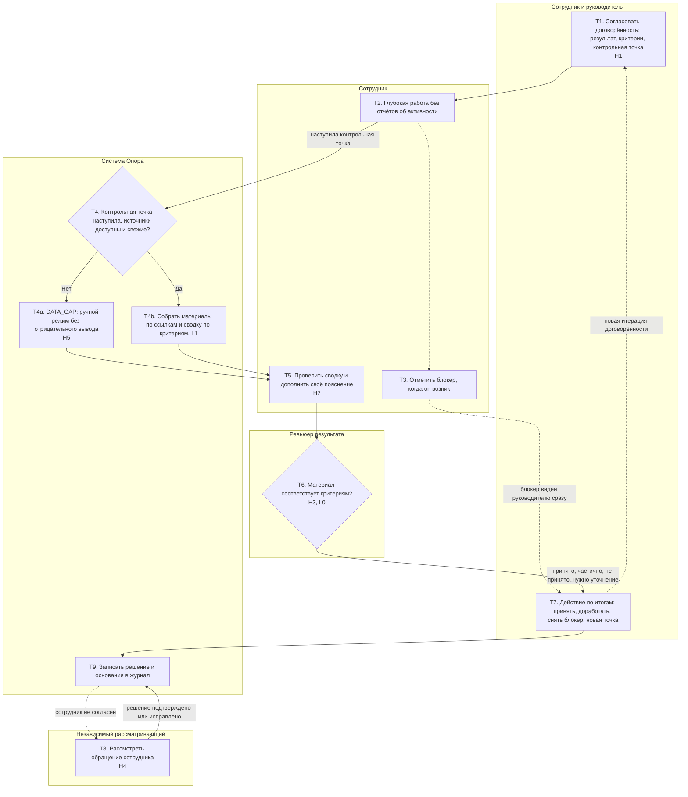
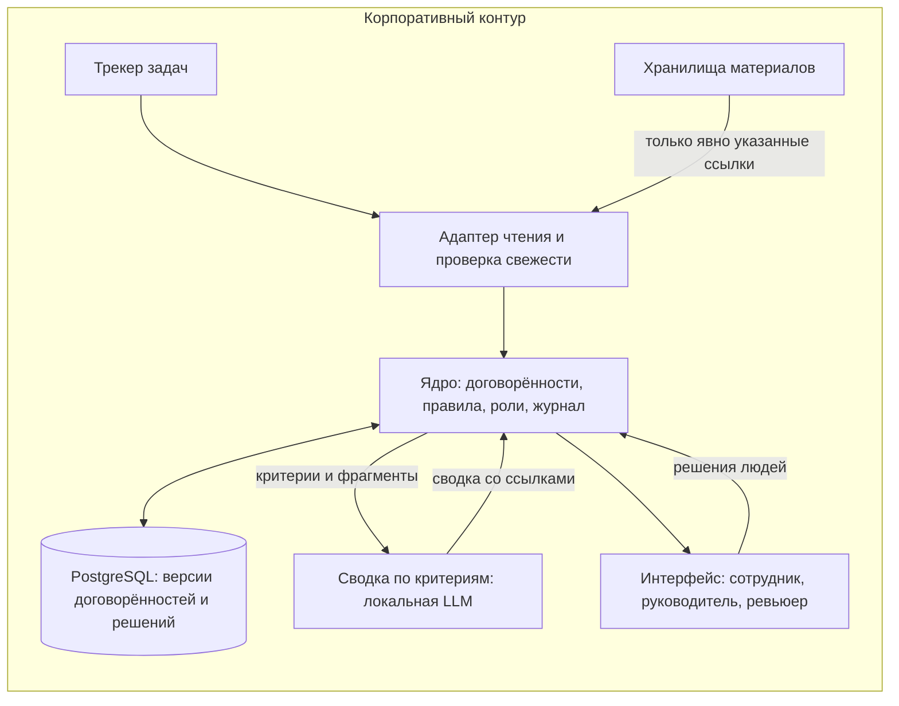

# Опора — целевой процесс и архитектура

**Суть изменения.** Вывод о работе сотрудника перестаёт строиться на счётчике активности (AS-IS, A5–A7) и строится на заранее согласованной договорённости о результате: что считается результатом, по каким критериям его проверяют, когда контрольная точка и что мешает. Внеплановые запросы статуса заменяются контрольными точками, а сбор активности для оценки человека отключается. ИИ готовит справочную сводку материалов по критериям, но не оценивает человека и не принимает решений.

## Целевой процесс



| Шаг | Роль | Вход → выход | Что меняется относительно AS-IS | Закрывает | Автоматизация |
|---|---|---|---|---|---|
| T1 | Сотрудник и руководитель | Задача → договорённость: ожидаемый результат, 2–5 критериев, контрольная точка, зависимости | Критерии фиксируются до начала работы, а не выясняются на приёмке | P1, P4 | L0: решают люди, система хранит версию |
| T2 | Сотрудник | Договорённость → материал и знание | Нет ежедневного учёта активности и оценки по нему: шаги A3–A6 для оценки человека убраны | P3, P6 | — |
| T3 | Сотрудник | Возникшее препятствие → блокер с владельцем зависимости | Блокер виден сразу и не путается с отсутствием результата | P2, P4 | Правило: уведомить руководителя |
| T4 | Система | Контрольная точка → проверка свежести и доступности источников | Пропуск данных — отдельное состояние, а не «нет активности» | P1, P5 | Правило, без ИИ |
| T4a | Система | Пробел в данных → ручной режим | Технический сбой не превращается в отрицательный вывод | P1 | Правило |
| T4b | Система | Ссылки на материалы и критерии → сводка со ссылкой на источник по каждому критерию | Руководителю не нужно запрашивать пересказ: контекст собран из материалов | P2 | ИИ, L1 |
| T5 | Сотрудник | Сводка → исправления и пояснение | Сотрудник видит то же основание, что и ревьюер, до решения | P1, P2 | L0 |
| T6 | Ревьюер | Материал, критерии, пояснение → исход по каждому критерию | Проверяется результат по критериям, а не активность | P1, P4, P5 | L0 |
| T7 | Сотрудник и руководитель | Исход и блокеры → действие и следующая точка | Невыполнение фиксируется как конкретное расхождение с действием, а не как «низкая активность» | P4, P5 | L0 |
| T8 | Независимый рассматривающий | Обращение → подтверждение или исправление решения | Появляется реальное оспаривание у человека, не участвовавшего в решении | P1 | L0 |
| T9 | Система | Решение → запись с основаниями и версией входа | Каждое решение можно восстановить и оспорить | P5, P6 | Правило |

**Что убрано из AS-IS.** Интерпретация отчёта активности A5–A7, внеплановые запросы статуса A8 и стимул к обходному пути W1: если оценка не строится на счётчике, поддерживать видимость бессмысленно. Учёт времени в трекере может остаться для планирования, но не используется как основание вывода о человеке.

**Если человек действительно не выполняет работу.** Система не скрывает невыполнение. В T7 фиксируются согласованный результат, прошедший срок, отсутствующий материал, проверенные источники, пояснение сотрудника и действие. Повтор после помощи и ясных договорённостей передаётся в отдельный человеческий процесс руководителя. Система не делает вывод о намерении и не запускает санкций.

### Ожидаемый эффект на потерях AS-IS

Те же формулы, что в [оценке потерь AS-IS](02_asis_analysis.md#оценка-потерь), команда из 8 человек.

| Параметр | AS-IS, базовый | TO-BE, базовый | TO-BE, пессимистичный | Почему меняется |
|---|---|---|---|---|
| Учёт и обновление договорённости, мин в день | 10 | 8 | 12 | Обновление карточки по событию вместо ежедневного журнала |
| Внеплановые запросы, в день | 1 | 0,25 | 0,5 | Статус виден из договорённости и блокеров |
| Поддержание видимости, мин в день | 10 | 0 | 0 | Счётчик активности не используется для оценки |
| Обзор руководителя, мин на сотрудника | 5 | 4 | 6 | Обзор договорённостей вместо отчёта активности |
| **Команда, ч в месяц** | **114,8** | **44,4** | **72,4** | |
| **Сокращение M1** | — | **61%** | **37%** | Цель этапа 1 — не менее 20% |

Числа TO-BE — проектные гипотезы, их проверяет пилот по дневнику затрат. Если обновление договорённости займёт больше 20 минут в день, выигрыш исчезает: это стоп-условие пилота.

## Обоснование альтернатив

### Как получены варианты: операторы разрешения противоречия

К противоречию C1 «качество результата ↔ демонстрация занятости» из [этапа 1](01_problem.md#противоречие) применены все восемь операторов. По каждому записана идея, которая вошла в целевой процесс, и сохранённая альтернатива: она участвует в сравнении ниже и остаётся запасным путём, если пилот не подтвердит выбранный вариант.

| Оператор | Идея | Что вошло в TO-BE | Сохранённая альтернатива |
|---|---|---|---|
| Время | Проверять не постоянно, а в согласованный момент | Контрольная точка вместо ежедневных отчётов и внеплановых запросов (T1, T4) | Скользящее окно оценки за 1–2 недели вместо дня |
| Пространство | Разделить, кто какие данные видит | Сотрудник видит всё по своей задаче, руководитель — свою команду, агрегаты — только по команде | Псевдонимизация: личные данные раскрываются только при обращении или с согласия |
| Условие | Разные требования для разных задач | Критерии задаются под тип задачи; обоснованный отрицательный результат исследования — выполненный критерий (T1) | Режимы работы «рывок» и «баланс» с разными ожиданиями |
| Структура | Отделить факты от оценки | Сводка фактов отдельно от решения; блокер отдельно от исхода (T3, T4b, T6) | Обучение руководителей и настройка полей действующего трекера (R7) |
| Синтез | Связать результат с контекстом | Сводка по критериям собирает материалы и пояснение сотрудника в одно основание (T4b, T5) | Еженедельный дайджест по задачам вместо живых цифр |
| Инверсия | Сначала искать, что мешает, а не кто виноват | Блокер с владельцем зависимости фиксируется до вывода о результате (T3) | Разбор препятствий на встрече команды без системы |
| Посредник | Ввести компетентного третьего | Ревьюер по критериям и независимый рассматривающий обращения (T6, T8); ИИ как посредник при чтении материалов | Выборочное ревью коллегами (R8) |
| Смена уровня | Улучшать процесс, а не оценивать человека | Агрегаты M1–M4 по команде для улучшения процесса, без рейтинга (T9) | Изменить частоту контрольных точек и распределение ревью без приложения |

### Сравнение вариантов

Критерии сравнения выведены из AS-IS: сколько проблем P1–P6 вариант закрывает, как меняет затраты E и R, какие данные собирает, насколько реализуем и какой риск неверного вывода о человеке создаёт. Оценка 1–5, где 5 — лучше.

| Вариант | Описание | P1–P6 (×3) | Затраты (×2) | Приватность (×2) | Реализуемость (×1) | Риск вывода (×2) | Итог |
|---|---|---|---|---|---|---|---|
| R5. Ничего не менять | Текущий процесс | 1 | 1 | 2 | 5 | 1 | 22 |
| R4. Единый индекс продуктивности по цифровым следам | Автоматический балл сотрудника | 1 | 3 | 1 | 3 | 1 | 18 |
| R7. Только политика | Запретить оценку по активности, обучить руководителей | 3 | 4 | 5 | 5 | 3 | 39 |
| R8. Выборочное ревью коллегами | Проверять случайную выборку результатов | 3 | 3 | 4 | 4 | 3 | 33 |
| R0. Договорённость в трекере вручную | Шаблон карточки и ревью без сервиса | 4 | 3 | 5 | 5 | 4 | 41 |
| **R2. Договорённость + правила + чтение трекера + сводка ИИ L1** | **Выбранный вариант** | **5** | **4** | **4** | **3** | **4** | **44** |

Итог = 3·P + 2·З + 2·П + 1·Р + 2·Риск.

**Почему выбран R2.** Он закрывает все шесть проблем. P1 и P5 закрываются тем, что вывод строится на критериях, а не на счётчике. P2 — тем, что сводка собирается из материалов, а не из пересказа. P4 — согласованием критериев в T1. P3 и P6 — отказом от ежедневной отчётности. R0 — его ручная версия, и она становится первым шагом внедрения: шаблон карточки проверяется в трекере до разработки сервиса. R7 дешевле, но оставляет руководителя без замены отчёту активности. Тогда он возвращается к запросам статуса, и P2 с P3 сохраняются. R4 отклонён: он автоматизирует именно ту подмену, которую выявил AS-IS (Л9: мониторинг не связан с производительностью, ρ = −0,01).

**Почему ИИ, а не правило.** Наступление срока, заполненность полей, свежесть источника и маршрутизацию решают обычные правила — там ИИ не нужен. ИИ нужен в одном месте: материалы сложной работы неоднородны. Это текст документа, описание в пул-реквесте, таблица сравнения, отрицательный результат эксперимента. Правило не может сопоставить такой текст с критерием «сравнить два подхода по ограничениям». ИИ находит в материалах фрагменты, относящиеся к каждому критерию, и ставит ссылку. Это экономит время ревьюера на чтение (Л6: 25% времени уходит на поиск информации). Решение по критерию принимает человек. Если ИИ отключить, процесс продолжает работать в режиме R0.

## Архитектура решения

Модульный монолит: один сервис и реляционная база внутри корпоративного контура. Интеграция только на чтение.



| Компонент | Назначение | Ответственность |
|---|---|---|
| Адаптер чтения | Получает поля задачи и материалы по явно указанным ссылкам, проверяет версию и свежесть | Только чтение; недоступность источника даёт DATA_GAP |
| Ядро | Договорённости и их версии, правила контрольных точек, роли и права, маршрутизация | Не вычисляет оценку человека и не пишет в кадровые системы |
| Сводка по критериям | Локальная модель возвращает по каждому критерию фрагменты материала со ссылкой или пометку «материал не найден» | Без доступа к сети и инструментам; выход проверяется по схеме, ссылки сверяются с входом |
| Журнал решений | Неизменяемая запись каждого решения и действия | Хранит хеш входа и версию модели; доступ к журналу тоже журналируется |
| Интерфейс | Карточка договорённости, сводка, решение по критериям, обращение | Сотрудник видит всё, что видит ревьюер по его задаче |

**Реализуемость.** Первая итерация — шаблон карточки в существующем трекере (R0), без разработки, две недели. Вторая — сервис с адаптером к одному трекеру и правилами контрольных точек: около 6–8 человеко-недель для одного разработчика. Третья — подключение локальной модели для сводки, включается флагом только после сравнения на размеченных примерах: сводка должна сокращать время ревьюера и не содержать утверждений без источника. Стек проверенный: API трекера на чтение, PostgreSQL, локальная открытая модель в контуре компании.

## Границы контура данных

Все данные остаются во внутреннем контуре. Внешние API языковых моделей не используются.

| Данные | Где хранится | Что уходит наружу | Чем защищено |
|---|---|---|---|
| Договорённость: результат, критерии, контрольная точка, блокеры | База Опоры | Ничего | Права по ролям; видят сотрудник, его руководитель и назначенный ревьюер |
| Материалы работы | В исходных системах; в Опоре только ссылка, версия и хеш | Ничего | Исходные права доступа сохраняются |
| Фрагменты для сводки | Передаются локальной модели на время запроса | Ничего | Модель без сети и инструментов; фрагменты не логируются целиком |
| Решения ревьюера и обращения | База Опоры, журнал | Ничего | Неизменяемые версии, срок хранения 90 дней после закрытия |
| Агрегаты процесса M1–M4 | База Опоры | Ничего | Только по команде; срезы меньше 5 человек не показываются |

**Не собирается:** клики, клавиатура, снимки экрана, время в сети, личная переписка, геолокация, сводный балл человека.

## Human-in-the-Loop

### Уровни автоматизации

| Уровень | Что делает система | Где применяется в Опоре | Почему |
|---|---|---|---|
| L0 | Человек делает всё, система хранит | Согласование критериев (T1), решение по критериям (T6), действие (T7), обращение (T8), любые кадровые решения вне системы | Ошибка затрагивает оценку человека и может быть необратимой; ст. 86 ТК РФ запрещает основывать решения о работнике на данных, полученных исключительно автоматизированной обработкой |
| L1 | Система готовит сводку, человек решает | Сводка материалов по критериям (T4b) | Ошибка сводки обратима: ревьюер видит первоисточник рядом, сотрудник проверяет сводку в T5 |
| L2 | Система предлагает, человек подтверждает | Предложение следующей контрольной точки по типу задачи | Цена ошибки низкая: дата меняется до подтверждения |
| L3 | Действует сама ниже порога риска | Только правила без ИИ: напоминания о контрольной точке, DATA_GAP при недоступном источнике | Действия не затрагивают оценку и полностью обратимы |
| L4 | Действует без человека | Не применяется | — |

Правило выбора уровня: чем выше цена ошибки и чем хуже она обратима, тем ниже уровень. Вывод о человеке, санкции и решения о премии, повышении или увольнении в системе не принимаются, а в связанных процессах — не выше L1.

**Почему нет автоматического роутера по порогу уверенности для решений.** Типовая схема HITL — модель решает сама при высокой уверенности, а пограничные случаи отдаёт человеку. Здесь она не подходит: исход по критерию — вывод о работе конкретного человека, ошибку дорого исправлять, а ст. 86 ТК РФ запрещает основывать такие решения только на автоматической обработке. Поэтому порог используется не для решения, а для внимания ревьюера. Критерии со статусом «частично», «материал не найден» или со сводкой, не прошедшей проверку ссылок, выделяются как пограничные, и ревьюер начинает с них. Протокол решения создаётся при каждом исходе: кто решил, по каким источникам, принял ли сводку. По нему видно, что решение действительно принимал человек.

### Точки вмешательства

| ID | Точка решения | Уровень | Условие срабатывания | Право на отказ | Срок | Эскалация | Куда попадает лог |
|---|---|---|---|---|---|---|---|
| H1 | Согласование договорённости (T1) | L0 | Новая задача или изменение результата, критериев или срока | Сотрудник может отклонить неясный критерий с причиной; договорённость не активируется без обеих сторон | До начала работы; при изменении — 1 рабочий день | Руководитель руководителя, если согласие не достигнуто за 2 рабочих дня | Обе версии договорённости и причина изменения |
| H2 | Проверка сводки сотрудником (T5) | L0 | Сводка готова или зафиксирован DATA_GAP | Сотрудник исправляет факты, добавляет пояснение или отмечает несогласие | 1 рабочий день | Без ответа ревью идёт по доступным фактам, но молчание не считается согласием и это отмечается в решении | Сводка, исправления, пояснение или отметка «нет ответа» |
| H3 | Решение по критериям (T6) | L0 | Наступила контрольная точка и есть материал или пояснение | Ревьюер может отклонить сводку ИИ целиком и работать по первоисточникам | 2 рабочих дня | Резервный ревьюер; если его нет — статус «ожидает ревью» без исхода | Исход по каждому критерию, использованные источники, принята ли сводка |
| H4 | Обращение сотрудника (T8) | L0 | Сотрудник не согласен с фактом или решением | Рассматривающий, не участвовавший в решении, может изменить исход | 2 рабочих дня на ответ, один повторный разбор | Владелец процесса; до ответа спорный исход не используется в других процессах | Исходное решение, обращение, ответ и новая версия |
| H5 | Сбой данных или сводки (T4a) | L0 | Источник недоступен или устарел, сводка не прошла проверку схемы или содержит ссылку вне входа | Ревьюер отказывается от сводки, работа идёт вручную | Сразу | Владелец интеграции | Ошибка, версия источника, факт отказа от сводки |

### Объяснимость

Пример вывода сводки по синтетической задаче «сравнить два подхода к кешированию по задержке и стоимости, дать рекомендацию».

```text
Критерий 1 «Сравнение по задержке»: найден материал.
  Источник: документ «Сравнение кешей», раздел 3, версия от контрольной точки.
  Фрагмент: таблица задержек p50 и p95 для двух вариантов на тестовом стенде.
Критерий 2 «Сравнение по стоимости»: найден частично.
  Источник: тот же документ, раздел 4. Есть стоимость инфраструктуры, нет стоимости поддержки.
Критерий 3 «Рекомендация с обоснованием»: материал не найден в указанных источниках.
  Пояснение сотрудника: рекомендация отложена — ожидается ответ команды инфраструктуры (блокер открыт два дня назад, владелец зависимости указан).
Использованные данные: договорённость версии 2, два документа по ссылкам, блокер. Активность, время в сети и число коммитов не использовались.
Почему не «все критерии найдены»: по критерию 3 нет фрагмента; по критерию 2 нет стоимости поддержки.
Что проверить человеку: корректность цифр в таблице задержек; достаточен ли частичный расчёт стоимости; подтверждён ли блокер владельцем зависимости.
```

Сводка не содержит оценки человека и общего балла. Уверенность модели не показывается: вместо неё виден проверяемый признак — есть ли ссылка на фрагмент по каждому критерию.

### Право на отказ и эскалация

| Точка | Может ли человек отклонить | Что происходит при отказе | Что если не ответил |
|---|---|---|---|
| H1 | Да, сотрудник и руководитель | Договорённость не активируется, критерий уточняется | Через 2 рабочих дня — эскалация руководителю руководителя |
| H2 | Да, сотрудник | Исправление попадает в материалы ревью рядом со сводкой | Ревью по доступным фактам с отметкой «сотрудник не подтвердил» |
| H3 | Да, ревьюер отклоняет сводку | Ревью по первоисточникам, отказ учитывается в оценке качества сводки | Резервный ревьюер, иначе статус «ожидает ревью» без исхода |
| H4 | Да, рассматривающий меняет исход | Новая версия решения, исходная сохраняется | Владелец процесса; спорный исход не используется |
| H5 | Да, ревьюер | Ручной режим | Уведомление владельцу интеграции; вывод не делается до восстановления данных |

## Риски ИИ и контрмеры

Пройден чек-лист из методических указаний: справедливость, прозрачность, данные, надёжность, влияние на людей, право, качество данных, безопасность.

| Риск | Категория | Сценарий | Контрмера в архитектуре | Уровень контроля | Проверка |
|---|---|---|---|---|---|
| Галлюцинация сводки | Надёжность | Сводка приписывает материал, которого нет | Каждое утверждение обязано ссылаться на фрагмент из входа; ссылки сверяются автоматически; без ссылки — «материал не найден» | L1, H3 | Набор из 20 размеченных задач: ноль утверждений без источника |
| Слепое доверие сводке | Влияние на людей | Ревьюер принимает сводку без чтения первоисточника | Решение ставится по каждому критерию отдельно, первоисточник открыт рядом; нет общего балла | L0, H3 | Контрольные задачи с заведомо неверной сводкой: ревьюер должен её отклонить |
| Сбой данных выглядит как невыполнение | Качество данных | Источник недоступен, материал «не найден» | Проверка свежести, DATA_GAP, запрет отрицательного вывода при пробеле | Правило, H5 | Тесты на недоступность, таймаут и устаревшую версию источника |
| Неравная оценка разных типов задач | Справедливость | Исследование с отрицательным результатом проверяется строже разработки | Критерии задаются под тип задачи в T1; отрицательный результат с обоснованием — допустимый результат | L0, H1, H3 | Парные кейсы разного типа; доля «не принято» по типам задач в агрегатах |
| Непонятно, на чём основано решение | Прозрачность | Сотрудник не знает, почему результат не принят | Сотрудник видит сводку и исход по каждому критерию с источником | L0, H2 | Опрос участников пилота: понятно ли основание решения |
| Подмена цели: снова считать активность | Влияние на людей | Руководство просит добавить метрики активности в отчёт | Нет таких полей и API; агрегаты только по процессу | L0 | Ревью схемы данных при каждом изменении |
| Утечка материалов | Безопасность, данные | Сводка или журнал раскрывают материалы посторонним | Локальная модель без сети; права по ролям; фрагменты не логируются целиком | L0 | Отрицательные тесты доступа; проверка, что модель не имеет сетевого выхода |
| Внедрение инструкции в материал | Безопасность | Текст документа содержит команду для модели | Материал передаётся как данные; модель без инструментов; выход проверяется по схеме | L1, H5 | Набор документов с внедрёнными инструкциями: маршрут и исход не меняются |
| Решение о работнике на основе автоматической обработки | Право | Сводка используется как основание кадрового решения | Система не формирует оценку человека; ст. 86 ТК РФ и ст. 16 152-ФЗ отражены в правилах использования | L0 | Аудит выгрузок и интеграций: нет передачи в кадровые системы |
| Новая отчётность дороже старой | Влияние на людей | Карточка требует больше времени, чем экономит | Ограничение полей, метрика M1, стоп-условие пилота | L0 | Дневник затрат: суммарное время не выше AS-IS |
| Перенос ответственности на ИИ | Влияние на людей | Ревьюер формально подтверждает сводку, считая, что «модель уже проверила» | Сводка не содержит исходов; решение по каждому критерию требует выбрать источник; в протоколе видно, открывался ли первоисточник | L0, H3 | Доля решений без открытия первоисточника в телеметрии |
| Потеря насмотренности ревьюера | Надёжность | Ревьюер, привыкший к сводке, перестаёт замечать проблемы, которых в сводке нет | Каждая пятая задача проверяется без сводки; расхождения со сводкой разбираются | L0, H3 | Сравнение исходов со сводкой и без неё на одинаковых типах задач |
| Предвзятость одного эксперта | Справедливость | Единственный ревьюер систематически строже к отдельным людям или типам задач | Рубрика по критериям; исход «не выполнен» видит резервный ревьюер; независимое обращение; доля «не принято» по ревьюерам в агрегатах | L0, H3, H4 | Калибровка ревьюеров раз в месяц на общих задачах |

**Принятые сознательно риски.** Компетентность и предвзятость ревьюера: система их снижает критериями и независимым обращением, но не устраняет. Невидимый вклад, не оставивший материалов, например помощь коллегам: фиксируется только через пояснение сотрудника. Небольшая команда может узнать человека по агрегату даже при пороге в 5 человек — поэтому агрегаты используются только для улучшения процесса.

## Логирование и аудит

```text
decision_id, timestamp, actor_id, actor_role, agreement_version,
input_hash, sources_used [source_id, version, fetched_at],
summary_model_version, summary_accepted,
criterion_outcomes [criterion_id, outcome, source_ids],
employee_response, override_reason, appeal_id, escalation_state
```

`input_hash` считается по договорённости, версиям материалов и пояснению сотрудника. По нему можно доказать, на каких данных принималось решение, и оспорить его. Журнал только дополняется: исправление создаёт новую запись со ссылкой на прежнюю. Доступ к журналу есть у владельца процесса и рассматривающего обращение по назначенному кейсу; каждый просмотр и экспорт журналируются. Срок хранения — 90 дней после закрытия последнего обращения, затем остаются только метаданные без содержания.

### Телеметрия решения

Система меняется вместе с процессом, поэтому измеряется не только работа людей, но и работа самой Опоры. Показатели собираются по команде, без персонального рейтинга.

| Показатель | Что показывает | Порог реакции | Действие |
|---|---|---|---|
| Доля сводок, отклонённых ревьюером | Полезность сводки | Больше 30% за 2 недели | Выключить сводку для этого типа задач, разобрать примеры |
| Доля утверждений сводки без источника, найденных проверкой | Надёжность модели | Больше 0 | Блокировать выпуск версии модели |
| Время ревью со сводкой и без | Экономия времени ревьюера | Нет выигрыша на одинаковых типах задач | Сводка остаётся выключенной (R0) |
| Частота DATA_GAP | Качество интеграции | Больше 10% контрольных точек | Исправить адаптер, уведомить владельца источника |
| Доля обращений и изменённых исходов | Обоснованность решений, метрика M2 | Изменён каждый пятый оспоренный исход | Калибровка ревьюеров, уточнение рубрик |
| Внеплановые запросы статуса по дневнику | Достигнута ли цель TO-BE | Не снизились относительно AS-IS | Вернуться к операторам: пересмотреть частоту контрольных точек |
| Время обновления договорённости | Нагрузка сотрудника, метрика M1 | Больше 20 мин в день | Стоп-условие пилота |

## Пилот и следующее противоречие

**Пилот.** Одна команда из 6–10 человек, 2 недели замера исходного процесса по дневнику и 4 недели работы по TO-BE, не меньше 20 задач разных типов. Проверяются все функции T1–T9, включая обращение и DATA_GAP. Исходы пилота не используются в кадровых решениях. Пилот успешен, если M1 снизилась не меньше чем на 20%, M2 не ухудшилась, в сводках нет утверждений без источника, а время сотрудника не выросло. Иначе — повторный пилот с изменённым параметром или возврат к операторам и альтернативам R7 и R8.

**Какое противоречие возникает после пилота.** Если пилот успешен, ревью по критериям становится главным способом увидеть результат. Тогда проявляется C4: **нужно своевременно и содержательно проверять каждую контрольную точку, НО компетентных ревьюеров мало, и частые точки съедают их время.** Цену несёт ревьюер, а при перегрузке — сотрудник, который ждёт решения. Второе следствие: когда оценка по результату работает, трекеры активности теряют смысл, а руководство теряет привычный инструмент контроля. Отсюда противоречие «прозрачность результата ↔ привычка руководителя видеть процесс». Для C4 следующий оператор — посредник и смена уровня: выборочное ревью коллегами и распределение ревью внутри команды. Его проверяет следующий пилот.

## Ответы на пять вопросов защиты

| Вопрос | Ответ |
|---|---|
| Какое решение необратимо для человека? | Кадровое решение по итогам оценки. Оно вне системы; Опора даёт только основания по критериям, решение принимает человек (L0) |
| Где человек говорит «нет» и как это реализовано? | H1–H5: сотрудник отклоняет критерий и исправляет сводку, ревьюер отклоняет сводку, рассматривающий меняет исход. Каждый отказ — действие в интерфейсе с записью в журнал |
| Что будет, если модель ошибётся на массовой выборке? | Сводка выключается флагом, процесс работает вручную (R0). Ошибка не влияет на исходы, потому что решение по критериям принимает человек по первоисточнику |
| Как сотрудник узнает, что работала машина? | Сводка помечена как подготовленная моделью, с версией модели; сотрудник видит её до решения (H2) |
| Больше или меньше времени тратит человек? | По модели — меньше: 44 ч в месяц на команду вместо 115 ч в AS-IS. Если пилот покажет рост времени, вариант отклоняется |
